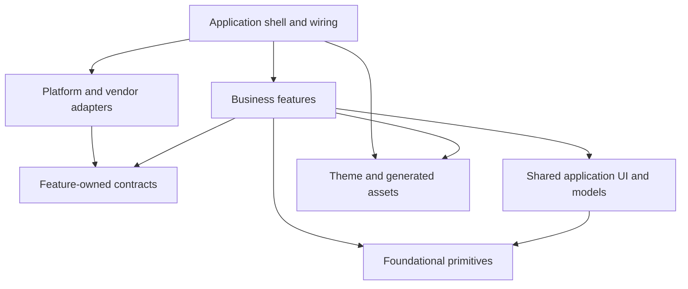

# Mobile Application Architecture Guide

This document captures the architecture patterns that can be used as a starting point for future mobile projects. Reuse the boundaries and decision process; adapt the framework, tooling, and domain-specific module graph to the project being built.

## Goals

- Keep business capabilities cohesive and discoverable by organizing code around features.
- Keep dependencies pointing toward stable contracts and foundational code.
- Isolate platform and vendor integrations so they can be replaced or tested independently.
- Keep presentation logic testable without requiring a running application or live services.
- Make important dependency rules executable in local checks and CI.

## Suggested Source Layout

```text
lib/
  app/          # Application entry, routing, global wiring, lifecycle
  core/         # App-independent primitives and cross-cutting contracts
  common/       # App-level shared UI and models used by multiple features
  features/     # Business capabilities, grouped by domain
  sdks/         # Platform/vendor adapters and external service integrations
  theme/        # Design tokens and theme configuration
  assets/       # Generated asset and localization references
```

Treat this as a useful default, not a required set of folders. Add a layer only when it has a distinct responsibility. Keep shared UI separate from foundational, UI-agnostic primitives; do not use `common` as a home for unrelated code or as a shortcut around feature ownership.

## Dependency Direction

Use a directed acyclic dependency graph. Application wiring is at the top; platform adapters implement contracts; features depend on their own contracts and on lower-level capabilities; foundational modules do not know about the app or its features. Theme and generated asset references should remain leaf-like dependencies.



The exact feature-to-feature graph is domain-specific. Prefer no feature-to-feature dependency when a contract, shared model, or shared UI component can express the collaboration more clearly. If one feature genuinely builds on another, record that direction explicitly and enforce it. Do not derive a universal ordering from this repository's feature names or ranks.

## Module Responsibilities

### Application shell (`app`)

Owns startup and shutdown, environment/flavor selection, top-level route composition, global observers, and dependency wiring. It may know about concrete adapters and feature entry points. Features should not import the application shell; expose a narrow contract from an appropriate lower layer when a feature needs a capability the shell supplies.

### Features (`features/<domain>`)

Own one business capability and keep its presentation, domain concepts, and required contracts together. A feature can start small and add subfolders only as needed. A common shape in this project is:

```text
features/<domain>/
  model/       # Feature-owned domain and presentation state types
  pages/       # Screens and their view models
  widgets/     # Feature-specific UI
  repository/  # Contracts the feature needs from outside
  router.dart  # Feature route declarations, when applicable
  index.dart   # Deliberate public API, when useful
```

Use MVVM when it helps separate screen rendering from state and interaction logic. Keep view models focused on presentation workflows; put reusable business rules in domain code rather than in widgets. Do not create empty folders or a view model for every screen by convention alone.

### Contracts and adapters (`repository`, `sdks`)

Declare an interface near the feature that consumes it. Implement it in an adapter module such as `sdks`, where vendor APIs, platform plugins, transport concerns, and generated wire models belong. Translate external data into app/domain types at this boundary. Presentation and feature code should not depend on SDK implementation classes or generated API types.

### Shared code (`common` and `core`)

Put code in `common` only when multiple parts of the app genuinely share an app-level concept or UI. Put app-independent primitives and cross-cutting contracts in `core`. Neither layer should import features; `core` should not import adapters. When two features share something, move the stable abstraction to an appropriate lower layer rather than importing one feature's internals from the other.

## Runtime Composition

Construct the dependency graph at the application boundary. Startup should initialize required platform services, select the environment, then provide dependencies to the app. The app shell binds feature contracts to concrete adapters; feature code consumes abstractions and remains unaware of which implementation was selected.

Keep lifecycle ownership explicit: the component that creates a resource should define who disposes it. Avoid hidden service locators and feature-level construction of global dependencies. Where multiple environments or test doubles exist, choose the implementation during app composition rather than branching throughout feature code.

## Navigation and Cross-Feature Workflows

Keep route definitions close to the feature they expose, while leaving global navigation configuration and cross-cutting guards in the app shell. Use a narrow navigation contract when a lower-level feature needs to request a transition whose destination is owned above it. Avoid importing another feature's pages or router to navigate directly into its internals.

For shared workflows, define the smallest contract needed by the caller and satisfy it at the composition boundary. Keep ownership of the route and final destination in the shell when the flow spans multiple features.

## Testing Strategy

- Unit-test view models, domain behavior, and transformations using fake feature contracts.
- Widget-test screens and reusable UI for user-visible states and interactions.
- Adapter-test SDK/platform implementations separately from feature behavior.
- Add a small number of integration tests for critical end-to-end flows and app composition.
- Keep test doubles aligned with contracts; regenerate generated mocks when the project uses code generation.

Tests should reinforce the same boundaries as production code. A feature test should not need live services, platform initialization, or unrelated feature implementations.

## Enforce the Architecture

Document dependency rules in one authoritative place, then add a fast static check to local development and CI. At minimum, check that:

1. Dependencies follow the declared layer and feature graph; peer features do not import each other accidentally.
2. Foundational and shared modules do not depend on features or the app shell.
3. Features depend on contracts, not concrete SDK/platform adapters.
4. Generated wire types stay within adapter and composition boundaries.
5. Exceptions are explicit, reviewed, and reduced over time rather than silently becoming precedent.

When introducing the check to an existing app, a checked-in baseline can prevent new violations while existing debt is reduced. A baseline should only shrink. Prefer package exports or feature entry points as public APIs; use deep imports only within a module unless there is a deliberate reason otherwise.

In this repository, the executable rules and feature ordering live in [`tool/check_layers.dart`](tool/check_layers.dart), and the remaining legacy violations are tracked in `tool/layer_baseline.txt`.

## Starting a New Project

1. Identify business capabilities and assign an owner to each feature.
2. Draw the dependency graph, including any intentional feature dependencies; keep it acyclic.
3. Create only the layers the project needs and agree what belongs in each.
4. For each feature, define its public API and the external contracts it consumes.
5. Implement platform/vendor adapters below the app composition boundary and map external types into app-owned models.
6. Wire implementations, routing, environments, and resource lifetimes in the app shell.
7. Add focused unit/widget/adapter tests and the architecture check before the module graph grows.
8. Revisit the graph when a shared concern or cross-feature dependency appears; move ownership instead of adding a shortcut import.
